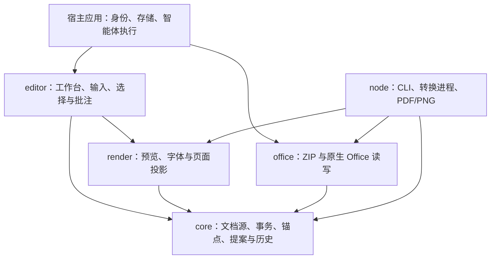

<p align="center">
  <picture>
    <source media="(prefers-color-scheme: dark)" srcset="docs/assets/doffi-logo-on-dark.svg">
    
  </picture>
</p>

<p align="center">
  <strong>让人与智能体，共同编辑同一份文档。</strong>
</p>

<p align="center">
  <a href="#文档"></a>
  <a href="https://www.typescriptlang.org/"></a>
  <a href="docs/development.md"></a>
  <a href="LICENSE"></a>
</p>

<p align="center">
  <a href="#快速开始">快速开始</a> |
  <a href="#架构">架构</a> |
  <a href="#文档">文档</a> |
  <a href="docs/implementation-plan.md">路线图</a> |
  <a href="COMMERCIAL-LICENSE.md">商业授权</a>
</p>

**doffi** 是面向人和宿主智能体协作的 TypeScript 办公文档 SDK 与可嵌入工作台。它以带语义的 HTML 文档包保存内容、样式、资源和批注，提供 Office 导入、浏览器编辑、框选批注、修改提案审阅与可编辑 Office 导出。Word、PPT 和 Excel 共用文档身份、事务与历史，各自保留适合的布局和编辑方式。

用户可以直接修改文档，也可以选中内容、添加批注，再由宿主智能体返回结构化提案。提案先在隔离候选中展示差异，确认后整批应用，并进入与人工编辑相同的撤销历史。达智是首个宿主；其他应用可通过普通 JavaScript、可选 React 包装或底层 API 接入。

> **当前进度：** 独立 Word 与 PPT 的读取、编辑、原生输出及打包闭环已完成。Excel 已完成声明范围的读取，以及编辑与计算阶段（[PR #31](https://github.com/RobotSe7en/doffi/pull/31)）；XLSX 原生导出、工作簿 PDF/PNG 和输出闭环仍待 R3-17～20。项目尚未发布 npm 包。

---

## 核心理念

**1. 一份可保存的文档源。**
HTML、CSS、格式元数据、资源和批注共同组成版本化文档包。编辑器 DOM、分页测量和公式计算结果均由源派生，保存与重开沿用同一格式。

**2. 人工与智能体共享事务。**
输入、对象操作、批注和模型提案均经过类型化事务。完整批次先校验，再提交一个修订和一个撤销步骤；候选预览保持隔离，过期提案按修订拒绝。

**3. 保留每种格式的语义。**
Word 使用流式正文与分页，PPT 使用固定画布与定位对象，Excel 使用分块来源、虚拟网格与第一方公式计算。共享协作协议，同时保留段落、幻灯片、单元格各自的结构。

**4. 原生格式处理与边界可核验。**
OOXML 读写、样式映射、公式解析和引用重写由本项目实现；ZIP、XML、哈希等通用能力复用成熟库。导入对不支持或超预算的结构明确失败，导出报告无法表达的批注等损失；独立来源、实际 Office 重存和固定字体参考共同验证已声明范围。

**5. 宿主拥有产品与智能体运行。**
SDK 管理文档、选区、批注、候选和历史。宿主提供身份、授权字节、资源、正式存储、模型执行与部署；批注请求和提案通过公开协议交换。SDK 可独立运行，也可嵌入宿主现有的工作空间。

## 支持进度

以下状态均限于各格式已声明的支持范围；完整 OOXML 兼容性仍需逐项验收。

| 格式 | 读取与预览 | 编辑与协作 | 原生输出与独立闭环 |
| --- | --- | --- | --- |
| Word / DOCX | 段落、样式、表格、图片、字段、经典批注与文字修订 | 富文本与中文输入、选择批注、提案差异、统一历史 | 可编辑 DOCX、PDF/PNG、JS/React/Node 打包与重开已完成 |
| PPT / PPTX | 主题、母版、布局、对象、三类基础图表、备注与两类批注 | 对象、文字、表格、定义、图表、批注及页面／全局提案 | 可编辑 PPTX、PDF/PNG、外部编辑与独立打包已完成 |
| Excel / XLSX | 样式、公式源、智能表、规则、图表、绘图、经典备注与现代线程 | 单元格、结构、排序筛选、表与规则、绘图、批注、提案及增量计算已完成 | 文档包可保存重开；原生 XLSX、工作簿 PDF/PNG 及输出闭环待实施 |

Excel 编辑阶段已通过最终源的日常与容量验收，覆盖一万行、20 万实际单元格、2 万公式及固定资源下的四引擎读取／编辑。范围与证据见[读取验收](docs/workbook-reading-acceptance.md)、[编辑验收矩阵](docs/workbook-editing-acceptance.md)及 [PR #31](https://github.com/RobotSe7en/doffi/pull/31)。

外部 Office 验收使用固定的 LibreOffice 25.8.1.1。已有 Excel 网页版名称语义观测仅适用于所记录的案例；Word／PowerPoint／WPS 尚未实机验证，删除合并区域首行／首列的 Excel 对照验收仍按用户决定延期。R1-15 达智集成验证延期，R1-16 的宿主验收仍有未完成项。正式宿主存储、多人实时共同编辑与发布准备见[整体计划](docs/implementation-plan.md)。

## 快速开始

### 运行 Playground

准备 Node.js 24 和 pnpm 10.28.2，在仓库根目录运行：

```bash
pnpm install --frozen-lockfile
pnpm dev
```

打开终端显示的本地地址，即可载入 Word、PPT 或一万行 XLSX 样例，也可打开自己的受支持文件。Playground 提供编辑、批注、撤销重做和文档包保存重开；Word/PPT 还可下载原生文件及 PDF。固定提案样例用于演示请求、差异审阅和整批应用，实际模型执行由宿主接入。

### 使用 SDK

五个库使用 `@doffi/*` 包名，目前通过 workspace 或本地 tarball 消费。下面的 Node.js 示例读取 DOCX、通过统一事务标记一条已有批注为已解决，再导出当前源：

```ts
import { readFile, writeFile } from "node:fs/promises";
import { createDocumentSession, openDocument } from "@doffi/core";
import { exportDocx, importDocx } from "@doffi/office";

const files = importDocx(new Uint8Array(await readFile("input.docx")), {
  documentId: "host-authorized-document",
});
const session = createDocumentSession(openDocument(files, { kind: "document" }));

try {
  const annotation = session.getAnnotations()[0];
  if (annotation) {
    const { documentId, revision } = session.snapshot().manifest;
    const candidate = session.prepare({
      protocolVersion: 1,
      documentId,
      baseRevision: revision,
      operations: [{
        op: "updateAnnotation",
        annotationId: annotation.annotationId,
        changes: { status: "resolved" },
      }],
    });
    session.commit(candidate);
  }

  const { bytes, report } = exportDocx(session);
  await writeFile("output.docx", bytes);
  console.log(report);
} finally {
  session.dispose();
}
```

浏览器工作台、请求生成与提案回传见[工作台与协议](docs/workbench.md)；原生导入导出范围见 [DOCX 读取](docs/docx-import.md)和 [DOCX 导出](docs/docx-export.md)。[报告文档包](examples/report/)、[请求](examples/report.request.json)与[提案](examples/report.proposal.json)提供可检查的协作样例。

### 开发与验证

```bash
pnpm check          # 架构边界、构建、类型、工程测试及 Playground 构建
pnpm pack:packages  # 在 .cache/packages 生成五个本地 tarball
```

浏览器安装、原生参考环境和独立打包验证见[本地开发](docs/development.md)。普通推送运行快速检查；阶段合并前显式执行完整日常与容量验收，见 [CI 执行](docs/ci-performance.md)。

## 架构



箭头表示代码依赖。`core` 定义格式模型与协作契约，`office` 负责原生格式转换，`render` 提供共享画布，`editor` 负责浏览器交互，`node` 管理服务端转换与渲染进程。

宿主通过请求／提案协议对接智能体，通过授权资源接口提供字节。文档 ID、节点 ID 和缓存键只用于关联；身份、权限与正式版本提交均由宿主控制。模块职责、运行环境和状态边界见[总体架构](docs/architecture.md)与[达智集成](docs/dagent-integration.md)。

## 项目结构

```text
packages/
  core/             文档模型、严格契约、事务、公式、锚点与历史
  render/           共享预览、字体、分页与源投影
  editor/           普通 JS 工作台、输入适配及可选 React 包装
  office/           ZIP/XML 适配、原生 Office 导入导出
  node/             CLI、受管理的 Chromium、PDF/PNG 与字节协议
apps/playground/    独立 React + Vite 演示宿主
docs/               设计、使用说明、验收记录与品牌素材
examples/           文档包、请求／提案及独立 DOCX/PPTX/XLSX 来源
scripts/            构建、打包、原生参考与验收工具
tests/              浏览器、集成及独立打包消费检查
```

各包通过公开入口消费能力。`core` 与 `office` 可用于浏览器及 Node，普通 JavaScript 工作台不要求 React；React 包装位于可选的 `@doffi/editor/react` 入口。

## 文档

| 入口 | 内容 |
| --- | --- |
| [总体架构](docs/architecture.md) · [三格式数据模型](docs/data-model.md) · [文档格式](docs/document-format.md) | 模块边界、唯一文档源与格式语义 |
| [结构契约](docs/contracts.md) · [文档模型](docs/document-model.md) · [事务与历史](docs/document-session.md) | 校验、读取、隔离候选、修订与撤销 |
| [工作台](docs/workbench.md) · [交互协议](docs/editing-protocol.md) · [选择与批注](docs/preview-interaction.md) | 普通 JS/React 接入、请求与提案 |
| [DOCX 读取](docs/docx-import.md) · [富文本输入](docs/rich-text.md) · [DOCX 导出](docs/docx-export.md) · [Word 闭环](docs/word-closure.md) | Word 支持范围、编辑与独立验收 |
| [PPTX 读取](docs/pptx-import.md) · [PPT 编辑](docs/presentation-editing.md) · [PPT 工作台](docs/presentation-workbench.md) · [PPTX 输出](docs/pptx-export.md) | 幻灯片对象、协作与原生输出 |
| [工作簿模型](docs/workbook-model.md) · [公式与引用](docs/workbook-formulas.md) · [读取验收](docs/workbook-reading-acceptance.md) · [编辑验收](docs/workbook-editing-acceptance.md) | Excel 分块模型、计算、范围和证据 |
| [分页与渲染](docs/pagination-rendering.md) · [中文字体](docs/fonts.md) · [资源与 ZIP](docs/resources-and-zip.md) | 页面投影、字体诊断与资源预算 |
| [整体计划](docs/implementation-plan.md) · [Word](docs/iteration-1.md) · [PPT](docs/iteration-2.md) · [Excel](docs/iteration-3.md) | 交付顺序、已定范围和阶段门槛 |
| [本地开发](docs/development.md) · [CI 执行](docs/ci-performance.md) · [技术选型](docs/technology-selection.md) · [开发约定](AGENTS.md) | 环境、命令、检查与依赖边界 |

## 许可

版权所有 © 2026 RobotSe7en。第一方代码、文档和示例按 **AGPL-3.0-only** 或另行签订的商业许可提供，详见 [LICENSE](LICENSE)、[NOTICE](NOTICE) 和[商业授权说明](COMMERCIAL-LICENSE.md)。第三方依赖、ECMA 材料及字体保留各自许可。
